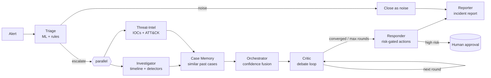

# SentinelCrew: an autonomous multi-agent SOC team

**Track:** AI / Cybersecurity (Multi-Agent Systems). Replace this with the exact track name from the competition brief.

   

SentinelCrew is a team of AI agents that works a security alert the way a good SOC shift does. It triages the alert, investigates, enriches it with threat intel, checks how similar cases ended in the past, argues about the verdict, contains the threat, and writes the report. A human approves anything high-risk.

What makes it different is **debate before escalation**. Before the crew acts on a verdict, a Critic agent tries to prove it wrong. It raises benign explanations, such as "is this our authorised scanner?", "was there an approved change?", or "is this the nightly backup?", and settles each one against real data, never opinion. False positives get closed before they reach an analyst, and real attacks come out of the debate with more confidence than they went in.

| Demo scenario | Without the Critic | With the Critic | Confidence |
|---|---|---|---|
| Brute force followed by account compromise | true positive | **true positive** | 0.87 → 0.97 |
| Authorised vulnerability scanner | needs review | **false positive** | 0.58 → 0.03 |
| Malware beaconing and exfiltration | true positive | **true positive** | 0.92 → 0.99 |
| Single mistyped password | noise | **noise** | closed at triage |
| Nightly backup upload | needs review | **false positive** | 0.46 → 0.20 |
| **Accuracy / analyst queue** | 60% / 4 cases | **100% / 2 cases** | |

To reproduce the table, run `python -m sentinelcrew evaluate`.

Demo video: _add YouTube link_. Hosted demo: _add link if hosted_. Technical design document: [`docs/technical_design.md`](docs/technical_design.md) (also available as a Word document).

---

## The crew



| Agent | What it does | How |
|---|---|---|
| **Orchestrator** | Runs the workflow graph, merges the scores, isolates failures | State graph with conditional edges, parallel fan-out, and a step budget |
| **Triage** | Scores the alert and filters noise | From-scratch Isolation Forest over 11 behavioural features, plus expert rules |
| **Investigator** | Builds the timeline and correlates evidence | Two-hop entity pivot and seven detectors; the LLM writes the hypothesis |
| **Threat-Intel** | Checks IPs, domains, and hashes; maps to MITRE ATT&CK | Local intel feed, allowlist, and ATT&CK keyword mapper |
| **Case Memory** | Recalls similar past incidents and what was done | TF-IDF vector store with cosine similarity |
| **Critic** | Argues against the verdict | Eight verifiable checks; the LLM chooses which ones and writes the commentary |
| **Responder** | Contains the threat | Allow-listed simulated actions, risk gating, protected targets |
| **Reporter** | Writes the incident report | Sections are rendered from the evidence; the LLM writes the executive summary |

The design principle is that **the LLM proposes and the tools verify**. Every number, verdict, and action is produced by deterministic, tested code. The LLM handles the parts it's good at: hypotheses, which challenges to raise, and narrative. Its output must pass a JSON schema with enum-restricted fields, so it cannot invent a check, a target, or an attack stage. If the LLM is down or no key is set, the crew keeps working in deterministic mode and reaches the same verdicts.

## Quick start

You need Python 3.10 or newer. Docker is not required, and the only runtime dependency is NumPy. The commands below use **PowerShell** (the default terminal in Windows 11 and VS Code). Run the clone command from the parent folder where you want the project, then run the remaining commands from the cloned project directory:

```powershell
git clone https://github.com/<you>/sentinelcrew.git
Set-Location sentinelcrew
py -m venv .venv
.\.venv\Scripts\Activate.ps1
python -m pip install -r requirements-dev.txt
python -m pip install -e .

Copy-Item .env.example .env  # then add your key(s), see "Choosing the LLM"
sentinelcrew check-llm        # confirms the key works
sentinelcrew serve            # open http://127.0.0.1:8000
```

If PowerShell blocks virtual-environment activation, allow scripts for this terminal session only, then activate the environment:

```powershell
Set-ExecutionPolicy -Scope Process -ExecutionPolicy Bypass
.\.venv\Scripts\Activate.ps1
```

Click a scenario in the left rail to watch the agents work it live. When a case finishes, its file opens on the right with the verdict, the confidence trace, every challenge the Critic raised, and approve or reject buttons for high-risk actions.

You can also do everything from the terminal:

```powershell
sentinelcrew scenarios                    # list demo scenarios
sentinelcrew run 01_bruteforce_compromise # stream the agent conversation
sentinelcrew run all --quiet              # every scenario, summary only
sentinelcrew analyze data\samples\alerts.json --events data\scenarios\03_beacon_exfiltration\logs.jsonl
sentinelcrew evaluate                     # with/without-Critic comparison
sentinelcrew train                        # retrain the triage model
```

If you haven't run `python -m pip install -e .`, set `PYTHONPATH` for the current PowerShell session before using `python -m sentinelcrew`:

```powershell
$env:PYTHONPATH = "src"
python -m sentinelcrew scenarios
```

## Choosing the LLM

Both providers are built in and swappable through configuration. No code change is needed.

| Use | Setting in `.env` |
|---|---|
| Testing and demo with Gemini | `LLM_PROVIDER=gemini` and `GEMINI_API_KEY=...` |
| Production with Anthropic Claude | `LLM_PROVIDER=anthropic` and `ANTHROPIC_API_KEY=...` |
| Follow the environment automatically | `LLM_PROVIDER=auto`; `APP_ENV=development` uses Gemini and `APP_ENV=production` uses Claude |
| No LLM (CI, air-gapped) | `LLM_PROVIDER=offline` |

To override for a single command, use `sentinelcrew --provider anthropic run all`. The models are set with `GEMINI_MODEL` (default `gemini-2.5-flash`) and `ANTHROPIC_MODEL` (default `claude-sonnet-4-5`).

To set Gemini configuration in the current PowerShell session instead of editing `.env`, use:

```powershell
$env:APP_ENV = "development"
$env:LLM_PROVIDER = "gemini"
$env:GEMINI_API_KEY = "your-api-key"
sentinelcrew check-llm
```

## Tests

```powershell
python -m pytest --cov=src/sentinelcrew --cov-report=term-missing  # 178 tests, about 99% line coverage
python -m unittest discover -s tests -t .                   # works without pytest too
```

The tests need no network and no API keys. LLM behaviour is tested with a scripted fake LLM and a fake HTTP transport, covering valid JSON, malformed JSON with corrective retry, provider errors, outages, and attempts to escape the allow-lists.

## Deployment

The service is a single process with no framework dependencies, so it drops into your existing DevOps pipeline:

```powershell
python -m pip install .                          # or: python -m pip install -r requirements.txt
$env:APP_ENV = "production"
$env:LLM_PROVIDER = "anthropic"
$env:ANTHROPIC_API_KEY = "your-api-key"
sentinelcrew serve --host 0.0.0.0 --port 8000   # health check: GET /api/health
```

PowerShell environment variables set with `$env:` apply to the current terminal session and processes started from it. For local development, you can instead put the settings in `.env`; do not commit real API keys.

The process is stateless apart from `var/` (the SQLite case database, the trained model, and reports). Mount `var/` on persistent storage or point `SENTINEL_VAR_DIR` at it. The API reference and operational notes are in the [technical design document](docs/technical_design.md#7-setup-and-deployment).

## Repository layout

```
src/sentinelcrew/
  agents/          triage, investigator, threat-intel, memory, critic, responder, reporter
  orchestration/   graph engine, shared state, SOC workflow
  llm/             Gemini + Anthropic clients, JSON guardrails, retry, scripted fake
  ml/              Isolation Forest (NumPy, from scratch), features, training
  tools/           log store, threat intel, MITRE mapper, org context, simulated actions
  memory/          SQLite case store, TF-IDF vector memory
  ingestion/       JSON / JSONL / CSV / syslog parsers and normaliser
  api/             REST API + analyst console (static/index.html)
  scoring.py       confidence fusion
  service.py       application service (used by CLI, API, UI)
  evaluation.py    with/without-Critic benchmark
data/              scenarios, intel feed, ATT&CK subset, org context, historical cases
docs/              technical design document, demo video script
tests/             unit/ and integration/
scripts/           generate_data.py (regenerates the synthetic data set)
```

## Assumptions and limitations

All response actions run in a **simulated** environment, and nothing touches real infrastructure. The telemetry, intel feed, and organisation context are **synthetic** and are regenerated by `scripts/generate_data.py`. The triage model is trained on a synthetic baseline of normal behaviour; in production you would retrain it on your own known-good telemetry. Full details are in the design document.

## License

MIT
