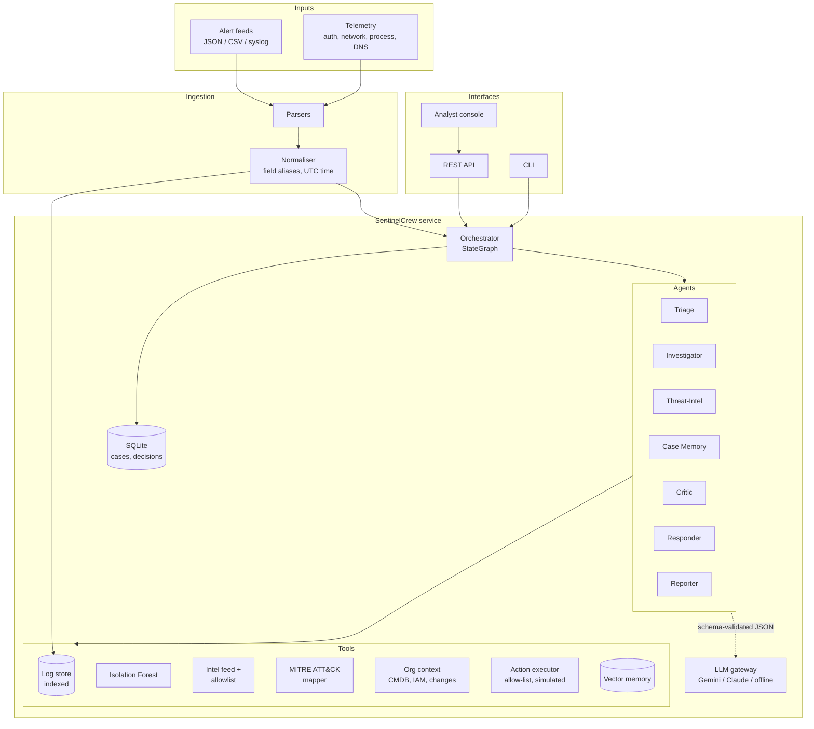
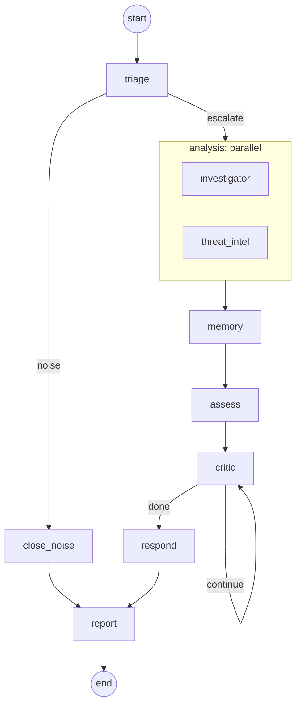
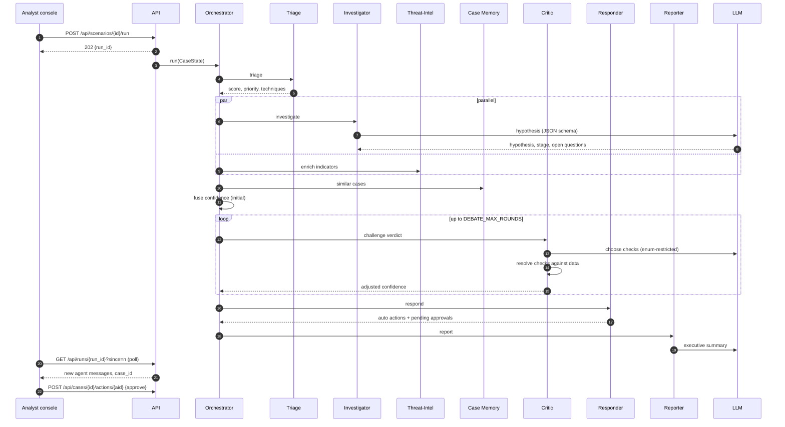
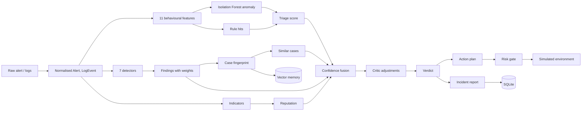
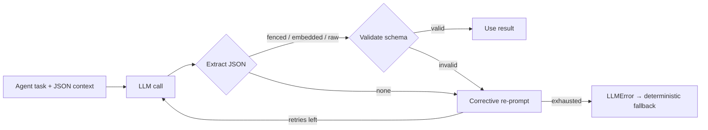

# SentinelCrew: Technical Design Document

| | |
|---|---|
| Project | SentinelCrew, an autonomous multi-agent SOC team |
| Track | AI / Cybersecurity (Multi-Agent Systems). Replace with the exact track name from the brief |
| Version | 1.0.0 |
| Author | Vinay Gandhi |
| Date | 11 October 2026 |
| Repository | `https://github.com/<you>/sentinelcrew` |
| Demo video | _YouTube link_ |

---

## 1. Project overview

### 1.1 The problem

A Security Operations Center (SOC) receives thousands of alerts a day. Industry surveys put the false-positive share at well over half, and every alert costs an analyst the same repetitive routine: pull the logs, look up the IPs, check whether IT was doing maintenance, decide, contain, and write it up. Real incidents wait in the same queue as noise, and the time lost there is time an attacker has inside the network.

### 1.2 The solution

SentinelCrew is a team of specialised AI agents that works each alert end to end, the way a disciplined human shift would. A Triage agent scores the alert with a machine-learning model and expert rules. An Investigator and a Threat-Intel agent then work in parallel to build the evidence. A Case-Memory agent recalls how similar incidents ended. The Orchestrator fuses all of this into one confidence score. The next stage is what most automated triage leaves out: a **Critic** agent argues against the verdict before anyone acts on it. After the debate, a Responder contains the threat under a risk policy that keeps a human in charge of anything disruptive, and a Reporter writes the incident report.

### 1.3 What is new

| Idea | Why it matters |
|---|---|
| **Debate before escalation** | The Critic raises benign explanations and settles each one against real data: the asset inventory, the change calendar, the allowlist, threat intel, and past cases. Upheld challenges lower confidence and refuted ones raise it. In the benchmark, this alone takes accuracy from 60% to 100% and halves the analyst queue. |
| **LLM proposes, tools verify** | The LLM picks hypotheses, chooses challenges, and writes narrative. Every number, verdict, and action comes from deterministic, tested code. LLM output must pass a JSON schema with enum-restricted fields, so it cannot invent a check, a target, or an attack stage. |
| **Graceful degradation** | Without an API key, or during an LLM outage, every agent falls back to deterministic reasoning and the verdicts stay the same. This is verified by tests. |
| **Hybrid AI** | An unsupervised Isolation Forest (written from scratch in NumPy, explainable, and saved as JSON), expert rules, noisy-OR evidence fusion, a TF-IDF case memory, and LLM reasoning. |
| **Measurable value** | A built-in benchmark compares runs with and without the Critic. The console shows the auto-close rate, mean time to verdict, and pending approvals. |
| **Human-in-the-loop** | Low-risk actions run automatically. Medium-risk actions run only at high confidence. High-risk actions always wait for an analyst, and protected assets can never be actioned. |

### 1.4 Scope of the MVP

The MVP covers the full alert lifecycle across five scripted, realistic scenarios: two real attacks, two convincing false positives, and one piece of plain noise. It includes ingestion of JSON, JSONL, CSV, and syslog alerts and logs; both LLM providers; a REST API; a live analyst console; a CLI; persistence; and a test suite of 178 tests. Response actions are simulated by design.

---

## 2. System architecture

### 2.1 High-level architecture



The system is one Python package arranged in layers. Interfaces (CLI, API, console) call a single `SentinelService`. The service owns the toolkit and the workflow. Agents receive the toolkit through dependency injection, so every agent can be tested in isolation with fakes.

### 2.2 Agent workflow (orchestration graph)



The graph runs on a small engine modelled on LangGraph (`orchestration/graph.py`). It supports sequential edges, conditional routing (which is how the debate loop and the noise short-cut are built), and parallel fan-out on a thread pool. Two safety properties are enforced by the engine itself:

- **Termination.** There is a hard `max_steps` budget (10 + `DEBATE_MAX_ROUNDS`), so a faulty router can never loop forever.
- **Failure isolation.** If a node raises, the Orchestrator records the error, posts it to the agent conversation, and continues with whatever data exists. A crashed Threat-Intel agent still produces a verdict and a report.

### 2.3 Sequence of a case



### 2.4 Data flow



---

## 3. AI models and algorithms

### 3.1 Triage: hybrid anomaly detection

**Features.** For every alert, the Triage agent pulls the telemetry within ±180 minutes that touches any of the alert's entities and computes 11 behavioural features: failed-auth count, distinct users targeted from the source, success after five or more failures, off-hours, external source, MB sent outbound, distinct destination ports, beacon regularity, suspicious process, severity hint, and asset criticality from the CMDB.

**Beacon regularity** is the classic command-and-control heuristic. For connections to the same destination, the agent computes the coefficient of variation of the inter-arrival times and scores `1 − CV`. A perfectly periodic beacon scores close to 1. Large transfers (over 100 kB) are left out so that exfiltration doesn't hide the beacon.

**Isolation Forest.** The model is a from-scratch implementation of Liu, Ting and Zhou (2008) in NumPy. It is trained unsupervised on normal behaviour, with 150 trees and a sub-sample of 256. The anomaly score is `s(x) = 2^(−E[h(x)] / c(n))`, where `c(n)` is the average unsuccessful-search path length of a binary search tree. Writing it ourselves rather than importing scikit-learn has three benefits. The model is **explainable**: each tree credits the feature whose split isolated the point, weighted by `1/depth`, and the top drivers appear in the triage reasoning. It **serialises to plain JSON**, so loading a model file can never execute code the way pickle can. And it keeps the dependency footprint to NumPy alone.

**Hybrid score.** `triage = 0.4 × anomaly + 0.6 × rules`. The raw anomaly score is mapped from [0.45, 0.70] to [0, 1]. The rules score is the noisy-OR of the rules that fired (for example, 10 or more failed logons, or a beacon regularity of at least 0.8). An alert is closed as **noise** only when its score is below `NOISE_THRESHOLD` *and* no rule fired, so the ML model on its own can never silence an alert that matches a known-bad pattern.

### 3.2 Investigator: correlation detectors

The Investigator does a **two-hop pivot**. First it gathers events for the alert's entities. Then it adds events for every host on which those entities logged on successfully, which is how a VPN brute force is connected to the workstation the attacker reached next. Seven detectors produce weighted findings tied to MITRE techniques:

| Detector | Signal | Technique | Weight |
|---|---|---|---|
| Brute force | 10 or more failures from one source | T1110 | 0.50–0.60 |
| Password spraying | 5 or more accounts from one source | T1110.003 | 0.45 |
| Success after failures | Logon after 5 or more failures (external source raises the weight) | T1078 | 0.50–0.65 |
| Suspicious process | Encoded PowerShell, LOLBins such as rundll32 and certutil, credential tools | T1059.001, T1218.011, T1059 | 0.55 |
| C2 beaconing | 6 or more small connections with regularity of at least 0.8 | T1071.001 | 0.60 |
| Exfiltration | 50 MB or more to one external destination | T1041 | 0.40–0.55 |
| Port scan | 20 or more distinct ports from one source | T1046 | 0.45 |

When an LLM is configured, it receives the findings and a timeline excerpt. It returns a hypothesis, the most advanced attack stage (restricted by enum to ATT&CK tactics), and up to five open questions for the Critic.

### 3.3 Threat-Intel

Indicators are taken from structured fields and extracted with regular expressions from free text. Domains are restricted to known TLDs, so usernames such as `j.mehta` and files such as `x.dll` aren't mistaken for domains. Internal RFC 1918 addresses are excluded. Each indicator is then looked up across the configured sources. The MVP ships a curated local feed with an organisation allowlist, and the `ThreatIntelSource` protocol makes MISP, OTX, or VirusTotal a drop-in addition. Matches on parent domains (`a.b.evil.com` matches `evil.com`) and merging across sources (taking the highest reputation and the union of tags) are supported.

### 3.4 Case memory

A TF-IDF vector store with L2-normalised sparse vectors and cosine similarity holds a fingerprint of every non-noise case: the rule, techniques, rule reasons, and finding titles. It is seeded with eight historical cases. The memory prior is the similarity-weighted share of malicious precedents, pulled back toward neutral (0.5) when similarity is weak. The `Embedder` protocol lets neural embeddings replace TF-IDF without changing any agent.

### 3.5 Confidence fusion

```
evidence = 1 − Π(1 − wᵢ)                    noisy-OR over findings
base     = Σ wₖ · componentₖ / Σ wₖ          k ∈ {triage 0.25, evidence 0.40, intel 0.25, memory 0.10}
final    = clamp(base + critic_adjustment, 0.01, 0.99)
verdict  = TP if final ≥ 0.70, FP if final < 0.40, otherwise NEEDS_REVIEW
```

Noisy-OR is used because independent pieces of evidence should reinforce each other without ever exceeding certainty. When a case has no external indicators, the intel term is removed and the remaining weights are re-normalised, so the absence of intel isn't counted as evidence of innocence.

### 3.6 The Critic and the debate protocol

The Critic holds a catalogue of eight **verifiable** challenges. Each one has an applicability test and an evaluator that resolves it against data:

| Check | Resolved against | Upheld impact | Refuted impact |
|---|---|---|---|
| Authorised scanner? | Asset inventory tag `authorized-scanner` | −0.30 | +0.02 |
| Approved change window? | Change calendar, by time and asset | −0.15 | 0 |
| Sanctioned destinations? | Allowlist versus known-bad intel | −0.20 | +0.03 |
| Single uncorroborated signal? | Strong findings across ATT&CK tactics | −0.06 | +0.03 |
| User mistyped a password? | Count and origin of failures | −0.15 | +0.02 |
| Similar past case was benign? | Case memory | −0.10 | +0.02 |
| Expected service-account automation? | IAM tags, plus no execution or exfiltration techniques | −0.10 | +0.02 |
| Independent intel corroboration? | Maximum reputation | −0.04 | +0.03 |

Each round, the Critic raises up to three challenges that haven't been raised yet. With an LLM, the model picks them. The JSON schema limits `selected_checks` to an enum of the applicable check IDs, so a hallucinated check is rejected and the heuristic order takes over. The model also writes the critical commentary. Each challenge resolves to **upheld**, **refuted**, or **unverifiable**. The adjustment accumulates within [−0.55, +0.10], so the Critic has more power to clear a case than to escalate one, which is deliberate. The debate stops when no applicable checks remain, when confidence moves by less than 0.005, or at `DEBATE_MAX_ROUNDS` (default 3).

### 3.7 Responder and risk policy

| Action | Risk | Policy |
|---|---|---|
| `add_to_watchlist`, `create_ticket`, `block_ip`, `block_domain` | Low | Automatic |
| `reset_sessions` | Medium | Automatic only if confidence ≥ 0.85, otherwise waits for approval |
| `disable_account`, `isolate_host` | High | Always waits for analyst approval |

Guardrails are enforced in code: only actions in the allow-list exist; targets come only from the case's own entities and malicious indicators, so the LLM cannot introduce a target; protected assets (domain controllers, built-in admin and `krbtgt`, public DNS resolvers) are rejected even with approval; and every execution is written to an audit log. All actions change an in-memory `SimulatedEnvironment`.

### 3.8 Reporter

The report's factual sections (entities, triage reasoning, evidence table, timeline, intel, similar cases, debate table, and actions) are rendered from case data, so they cannot drift from the evidence. The LLM contributes only the executive summary, the impact statement, and recommendations, and those are schema-validated too.

---

## 4. LLM integration

### 4.1 Providers

| Provider | Use | Endpoint | Auth |
|---|---|---|---|
| Google Gemini | Testing and demo | `generativelanguage.googleapis.com/v1beta/models/{model}:generateContent` | `x-goog-api-key` |
| Anthropic Claude | Production | `api.anthropic.com/v1/messages` (version `2023-06-01`) | `x-api-key` |
| Offline | CI, air-gapped | none | none |

The provider is chosen through configuration (`LLM_PROVIDER`). With `auto`, `APP_ENV=production` selects Claude and anything else selects Gemini, so the same build moves from demo to production by changing one environment variable. Both clients call the public REST APIs through a small standard-library transport. That keeps the dependencies minimal and lets tests inject a fake transport.

### 4.2 Structured output guardrail



`complete_json` adds the schema to the prompt and turns on Gemini's JSON MIME mode. It extracts JSON robustly, from fenced blocks, embedded in prose, or with braces inside strings. It then validates the result with a dependency-free JSON-schema validator (type, required, enum, bounds, item limits, and `additionalProperties`). If validation fails, the model is re-prompted with the exact error. Transport errors are retried with exponential back-off on 408, 429, 5xx, and 529. Usage (calls, failures, latency) is tracked and reported in `/api/metrics`.

---

## 5. Code explanations

### 5.1 Module map

| Module | Responsibility |
|---|---|
| `models.py` | Dataclass domain model (Alert, LogEvent, Finding, Case, ...) and JSON serialisation |
| `config.py` | Immutable `Settings` loaded from the environment or `.env`; provider resolution |
| `validation.py` | JSON-schema subset validator used as the LLM guardrail |
| `ingestion/` | Parsers for JSON, JSONL, CSV, and RFC 3164/5424 syslog; field-alias normaliser; UTC timestamps; severity scales |
| `llm/` | `LLMClient` base (retry, JSON extraction, usage), Gemini and Anthropic clients, factory, `ScriptedLLM` fake |
| `ml/` | Isolation Forest, feature extraction, synthetic baseline and training CLI |
| `tools/` | Indexed `LogStore`, `ThreatIntelService`, `MitreMapper`, `OrgContext`, `ActionExecutor` |
| `memory/` | `CaseStore` (SQLite, thread-safe, upserts, metrics) and `VectorStore` |
| `agents/` | The seven agents; `base.py` holds the `Toolkit` and the `ask_json` helper with fallback |
| `orchestration/` | `StateGraph` engine, thread-safe `CaseState`, `SOCWorkflow` wiring |
| `scoring.py` | Noisy-OR, memory prior, fusion, verdict thresholds |
| `service.py` | Bootstrapping, scenario loading, case lifecycle, memorisation, human decisions |
| `api/server.py` | Framework-free router (`SentinelAPI.dispatch`), background run manager, HTTP handler |
| `api/static/index.html` | Analyst console: live agent stream, confidence trace, approvals |
| `evaluation.py` | Benchmark comparing runs with and without the Critic |
| `cli.py` | `serve`, `scenarios`, `run`, `analyze`, `evaluate`, `train`, `check-llm` |

### 5.2 Key design decisions

**A custom graph engine instead of a LangGraph dependency.** The workflow needs exactly three primitives: edges, conditional edges, and parallel fan-out. A 200-line engine with full test coverage is easier to audit than a framework, has no version drift, and installs anywhere. Its API mirrors LangGraph's (`add_node`, `add_conditional_edges`, `set_entry_point`, `END`), so porting is mechanical if that's wanted later.

**Shared mutable state with locks.** `CaseState` is one object that every agent writes to, with an `RLock` around message emission. The parallel nodes write disjoint fields (`investigation` and `intel`), so they don't contend.

**Determinism.** Model training, the synthetic data, and the Critic's heuristic ordering are all seeded or ordered. Running the same scenario twice gives the same verdict, which the tests rely on.

**A framework-free API.** `SentinelAPI.dispatch(method, path, query, body)` is a pure function of its inputs, so every route is unit-tested without sockets. The HTTP handler is a thin adapter on top. Cases run on background threads under a single execution lock, which keeps the shared log store consistent while the UI polls `/api/runs/{id}` for new messages.

**Persistence.** The full case is stored as a JSON payload alongside indexed summary columns. Metrics are computed in SQL plus Python. Analyst decisions go into a separate `decisions` table, which serves as the audit trail.

### 5.3 REST API

| Method and path | Purpose |
|---|---|
| `GET /api/health` | Liveness, version, active LLM |
| `GET /api/scenarios` | Demo scenarios |
| `POST /api/scenarios/{id}/run` | Start a scenario, returns `run_id` |
| `POST /api/alerts` | `{"alert": {...}}` or `{"alerts": [...]}` with optional `"events"`; returns `run_ids` |
| `GET /api/runs/{run_id}?since=n` | Incremental agent messages, `done`, `case_id` |
| `GET /api/cases`, `GET /api/cases/{id}` | Case list and full case |
| `GET /api/cases/{id}/report` | Markdown report |
| `POST /api/cases/{id}/actions/{action_id}` | `{"approve": true, "analyst": "...", "comment": "..."}` |
| `GET /api/metrics` | Auto-close rate, mean time to verdict, debate shift, pending approvals, simulated environment, LLM usage |
| `GET /api/graph` | The workflow as Mermaid |

Errors return JSON with suitable status codes: 400 for malformed input, 404 for unknown resources, 405 for the wrong method, 409 for an action that isn't pending, 413 for a body over 2 MB, and 422 for alerts that can't be normalised.

---

## 6. Testing and reliability

### 6.1 Strategy

The suite has 178 tests, about 99% line coverage of `src/`, and runs in under 10 seconds with no network and no API keys. They are written with `unittest`, so they run under both `pytest` and `python -m unittest`.

| Area | What is tested |
|---|---|
| Ingestion (23) | Every timestamp form, severity scales, field aliases and nesting, CSV/JSON/JSONL/syslog, format detection, rejection of bad rows |
| LLM layer (26) | Payload shape and headers per provider, response parsing, blocked or empty responses, corrective retry, retry and back-off policy, factory selection, `auto` mode, missing key, scripted fake |
| Resilience (6) | Real HTTP transport against a local server (success, retryable and non-retryable status codes, invalid JSON, connection refused); a crashing agent doesn't kill the case |
| Tools (22) | Log indexing and OR-queries, intel allowlist, parent-domain and multi-source merge, ATT&CK mapping, change windows, every action, protected targets |
| ML (16) | `c(n)`, outlier ranking, determinism, explanations, JSON round trip, constant data, beacon regularity, feature extraction |
| Core (29) | Fusion maths, memory prior, vector search, SQLite upsert, rollback and metrics, config and `.env`, graph engine (loops, `max_steps`, true concurrency, error routing, validation) |
| Agents (33) | Each agent with and without a scripted LLM. The LLM cannot invent checks or stages, a benign explanation lowers confidence, a real attack survives the debate, the adjustment stays bounded, risk gating works, guardrails block protected targets, report sections are present |
| Integration (23) | All five scenarios reach the expected verdict; trace order; memorisation; approve and reject flow; full pipeline with a scripted LLM; **identical verdicts during an LLM outage**; every API route and error; a real HTTP round trip; every CLI command; the benchmark |

### 6.2 Edge cases covered

These are covered explicitly: malformed and empty logs, a record with no timestamp, an LLM returning prose instead of JSON, an LLM returning JSON that breaks the schema, an LLM outage, network timeouts, HTTP 429 and 503, a debate that never converges (stopped by `max_steps` and the round limit), a router returning an unknown label, a crashing agent inside a parallel branch, a broken UI listener, attempts to run an action not on the allow-list or against a protected target, a double approval, path traversal in a scenario ID, and oversized request bodies.

### 6.3 Running

```bash
pytest --cov=src/sentinelcrew --cov-report=term-missing
python -m unittest discover -s tests -t .
```

GitHub Actions (`.github/workflows/ci.yml`) runs the suite on Python 3.10, 3.11, and 3.12 with an 85% coverage gate.

---

## 7. Setup and deployment

### 7.1 Requirements

Python 3.10 or newer and NumPy. Nothing else is needed at runtime. Development adds pytest, pytest-cov, and ruff.

### 7.2 Local setup

```bash
git clone https://github.com/<you>/sentinelcrew.git && cd sentinelcrew
python -m venv .venv && source .venv/bin/activate    # Windows: .venv\Scripts\activate
pip install -r requirements-dev.txt && pip install -e .
cp .env.example .env                                  # add GEMINI_API_KEY and/or ANTHROPIC_API_KEY
sentinelcrew check-llm
sentinelcrew serve                                    # http://127.0.0.1:8000
```

The synthetic data is committed. To regenerate it, run `python scripts/generate_data.py`. The triage model is trained and cached in `var/models/` on first start. To retrain it, run `sentinelcrew train`.

### 7.3 Configuration reference

| Variable | Default | Meaning |
|---|---|---|
| `APP_ENV` | `development` | `production` makes `auto` choose Claude |
| `LLM_PROVIDER` | `auto` | `auto`, `gemini`, `anthropic`, or `offline` |
| `GEMINI_API_KEY` / `GEMINI_MODEL` | none / `gemini-2.5-flash` | Gemini credentials and model (`GOOGLE_API_KEY` also accepted) |
| `ANTHROPIC_API_KEY` / `ANTHROPIC_MODEL` | none / `claude-sonnet-4-5` | Claude credentials and model |
| `LLM_TEMPERATURE`, `LLM_TIMEOUT_S`, `LLM_MAX_RETRIES`, `LLM_MAX_TOKENS` | 0.1, 60, 2, 4096 | LLM behaviour |
| `DEBATE_MAX_ROUNDS` | 3 | Critic round limit |
| `NOISE_THRESHOLD`, `TP_THRESHOLD`, `FP_THRESHOLD` | 0.20, 0.70, 0.40 | Decision thresholds |
| `AUTO_MEDIUM_RISK_CONFIDENCE` | 0.85 | Confidence needed to auto-run medium-risk actions |
| `LOG_WINDOW_MINUTES` | 180 | Investigation window (±) |
| `SENTINEL_DATA_DIR`, `SENTINEL_VAR_DIR` | `./data`, `./var` | Reference data and runtime state |

### 7.4 Production deployment

Your DevOps team owns the packaging, so no container files are included. The service is a single process with a standard Python entry point:

```bash
pip install .
export APP_ENV=production LLM_PROVIDER=anthropic ANTHROPIC_API_KEY=<from your secret store>
export SENTINEL_VAR_DIR=/var/lib/sentinelcrew
sentinelcrew serve --host 0.0.0.0 --port 8000
```

| Concern | Guidance |
|---|---|
| Health check | `GET /api/health` returns 200 with the active provider |
| State | Only `SENTINEL_VAR_DIR` (SQLite, model, reports); put it on persistent storage |
| Secrets | Supply API keys as environment variables from your vault; `.env` is git-ignored |
| TLS and auth | Terminate TLS and add authentication (SSO or an API gateway) at your reverse proxy; the MVP has no built-in user authentication |
| Scaling | One process handles cases one at a time. Scale out by sharding alert sources across instances; for shared state, move `CaseStore` to PostgreSQL (one class) |
| Egress | Allow outbound HTTPS to `generativelanguage.googleapis.com` and/or `api.anthropic.com` only |
| Logs | Access logs go to stderr; case-level audit lives in the `decisions` table |

---

## 8. Assumptions and limitations

| Assumption or limitation | Detail |
|---|---|
| Simulated response | Every action changes an in-memory `SimulatedEnvironment`. Real EDR, firewall, or IdP connectors would implement the same `ActionExecutor` handlers. |
| Synthetic data | Telemetry, the intel feed, the ATT&CK subset (17 techniques), the CMDB, IAM, the change calendar, and historical cases are synthetic and reproducible (`scripts/generate_data.py`). No real customer data is used. |
| Triage baseline | The Isolation Forest is trained on a synthetic baseline of normal activity. In production you would retrain it on your own known-good telemetry, for example 30 days. |
| Time | All timestamps are normalised to UTC; "off-hours" means outside 07:00–20:00 UTC or a weekend. |
| LLM role | The LLM never decides a verdict or an action on its own. Its output is schema-validated and restricted to enums. Verdicts are deterministic given the data. |
| Small benchmark | The 100% accuracy is measured on five purpose-built scenarios that demonstrate behaviour. It is not a statistical claim about real-world precision. |
| Single tenant, no auth | The API has no built-in authentication. Deploy it behind your SSO or API gateway. |
| Concurrency | Cases are processed one at a time per instance to keep the shared log store consistent. |

## 9. Future work

Future work includes connectors for SIEM ingestion (Splunk, Sentinel, Elastic), real EDR and IdP actions behind the same allow-list, neural embeddings for case memory, analyst feedback that tunes the Critic's impacts (learning from approve and reject decisions), the full ATT&CK catalogue, and multi-tenant authentication.

## Appendix A: Demo scenarios

| Scenario | Story | Expected result |
|---|---|---|
| `01_bruteforce_compromise` | 46 off-hours VPN failures from a Tor exit node, then success, then RDP to a finance workstation | True positive. IP blocked and sessions reset automatically; account disable waits for approval |
| `02_scanner_false_positive` | 140-port scan of a DMZ server | False positive. The source is the authorised scanner under change CHG-2041; confidence goes from 0.58 to 0.03 |
| `03_beacon_exfiltration` | Word launches encoded PowerShell, a 60-second beacon to a C2 domain, rundll32, then 260 MB out | True positive. Domain and IP blocked; host isolation waits for approval |
| `04_low_value_noise` | One mistyped password | Noise. Closed at triage without running the other agents |
| `05_backup_false_positive` | 380 MB uploaded off-hours by `svc-backup` | False positive. The destination is allowlisted and it's the nightly backup |

